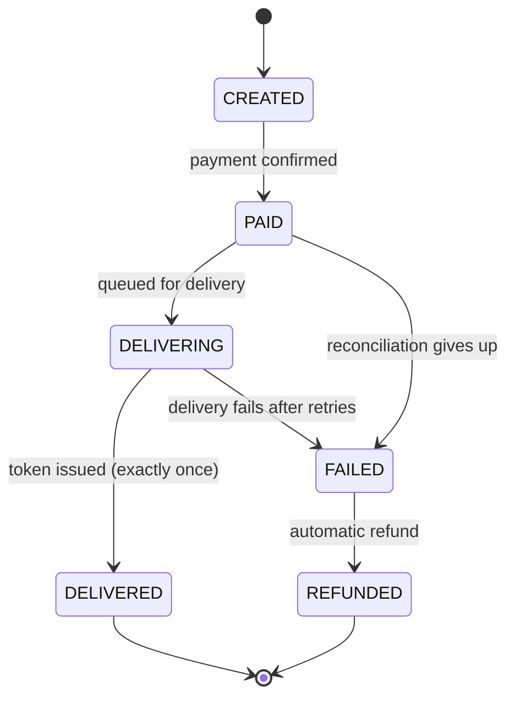

# tap-to-token-payment-reliability
Resilient payment-to-delivery pipeline on AWS: guarantees a paid ZESA token order ends in exactly one token or a refund. Built with Terraform, Lambda, DynamoDB and SQS. Simulation project.
video link: https://youtu.be/_fXECni6K5E

# Tap to Token

**A resilient payment-to-delivery pipeline, built around one painful moment: a customer pays for a ZESA token and nothing arrives.**

> **Status:** Work in progress. This is a simulation I built to show how I think about payment reliability, security and cost. It does not use any real payment provider, utility system or customer data, and it is not based on any company's internal systems.

---

## 1. The problem in plain English

Imagine a Zimbabwean in the UK. It is the 30th, 9pm, and her mother's electricity in Harare has run out. She buys a ZESA token online and taps **Pay**. The money leaves her account.

Then one of these happens behind the scenes:

| What goes wrong | What the customer experiences |
|---|---|
| The payment confirmation never reaches the system | Paid, but no token. No explanation. |
| The confirmation arrives **twice** | Two tokens issued, or a conflict that issues none |
| The electricity provider times out **after** the money is taken | Paid, token not delivered, system unsure what to do |
| A flood of month-end buyers overloads the system | Slow pages, failed payments, retries, duplicate attempts |

The customer is now stuck in limbo: **paid, but with no token and no clear answer.** She pays again, calls support, or stops trusting the service. For something as essential as electricity, that is a serious failure.

## 2. What this project does

**Tap to Token guarantees that every paid order ends in exactly one of two outcomes:**

1. **The customer receives exactly one token**, or
2. **The customer is automatically refunded.**

No double tokens. No orders stuck forever in "paid but not delivered". No manual cleanup.

It does this even when the surrounding systems misbehave: confirmations arrive twice, arrive late or never arrive, and the utility provider randomly times out.

## 3. Why this matters to a payment platform

These are the costs this design targets. They are the general costs any payment platform faces, not figures from a specific company.

- **Fewer support tickets and manual reconciliations**, because stuck payments resolve themselves.
- **No duplicate tokens or double charges**, which means fewer refunds and disputes.
- **Customer trust**, which repeat usage depends on, especially for diaspora customers paying for essentials from abroad.
- **Stable behaviour at month-end peaks**, without paying for peak capacity all month.
- **A known cost per transaction**, which matters when each sale is small and volumes are high.

## 4. How it works

├── terraform/              # all infrastructure as code
│   ├── main.tf, api.tf, dynamodb.tf, lambdas.tf
│   ├── phase2.tf           # queues, extra Lambdas, routes, secret, reconciler schedule
│   ├── demo.tf             # serves the demo page
│   └── modules/lambda_function/


### The order lifecycle

Every order moves through a strict set of states. It can never skip a step or go backwards.



### The four ideas that make it reliable

1. **Idempotency.** Every payment confirmation carries a unique reference. The database accepts it only once, using a conditional write. A duplicate confirmation is recognised and ignored, so a token can never be issued twice.
2. **Decoupled delivery.** Paid orders go onto a queue. If the utility provider times out, the worker retries. If retries keep failing, the order lands in a dead-letter queue instead of disappearing.
3. **Reconciliation.** A scheduled job looks for orders stuck in a state for too long (for example, a callback that never arrived). It asks the gateway for the real payment status and moves the order forward, or refunds it.
4. **Strict state machine.** Updates only succeed if the order is in the expected previous state, which prevents race conditions between the callback, the worker and the reconciler.

## 5. The chaos switch

Real systems fail in messy ways, so the mock gateway and mock utility provider have configurable failure modes:

| Setting | What it simulates |
|---|---|
| `DUPLICATE_CALLBACK_RATE` | The same confirmation sent more than once |
| `DELAYED_CALLBACK_RATE` | Confirmations that arrive minutes late |
| `LOST_CALLBACK_RATE` | Confirmations that never arrive |
| `PROVIDER_TIMEOUT_RATE` | The utility provider failing to respond |

The same traffic is then run through two versions of the system.

## 6. The proof: naive vs resilient

I run identical load, with the chaos switch on, against:

- **Naive version:** no idempotency, no reconciliation, no retries.
- **Resilient version:** the full design above.

| Metric | Naive | Resilient |
|---|---|---|
| Duplicate tokens issued | _to be measured_ | _to be measured_ |
| Orders stuck in limbo | _to be measured_ | _to be measured_ |
| Orders needing manual fixing | _to be measured_ | _to be measured_ |
| Paid orders ending as token or refund | _to be measured_ | _to be measured_ |

_These cells are filled in from the load test results. Nothing in this table is estimated._

## 7. Month-end load test

A [k6](https://k6.io) script simulates a month-end spike, with many customers buying tokens in a short window while the chaos switch is on. It records latency, error rates, queue depth and how the system recovers once the spike passes.

## 8. Security and governance

Everything is defined as code with Terraform, so controls are consistent and reviewable instead of manual.

- Least-privilege IAM role for each function, with only the permissions it needs
- Secrets kept in AWS Secrets Manager, never in code
- Audit logging enabled
- Consistent resource tagging
- _Optional extension:_ AWS WAF with rate limiting in front of the API

## 9. Cost visibility

Payments are high-volume and low-value, so small inefficiencies add up.

- Every resource is tagged so costs can be traced to this project
- An AWS Budget with alerts guards against surprises
- **Cost per 1,000 orders** is measured at different load levels and reported below once measured
- The stack is **destroyed when not in use**, and the commands to rebuild it are in the repo

| Load level | Cost per 1,000 orders |
|---|---|
| _to be measured_ | _to be measured_ |

## 10. Tech stack

| Layer | Tool |
|---|---|
| Infrastructure as code | Terraform |
| API | Amazon API Gateway |
| Compute | AWS Lambda |
| Data | Amazon DynamoDB |
| Messaging | Amazon SQS (with dead-letter queue) |
| Scheduling | Amazon EventBridge |
| Monitoring | Amazon CloudWatch |
| Load testing | k6 |

## 11. Repository structure (planned)

```
tap-to-token/
├── README.md
├── terraform/              # all infrastructure as code
│   ├── main.tf, api.tf, dynamodb.tf, lambdas.tf
│   ├── phase2.tf           # queues, extra Lambdas, routes, secret, reconciler schedule
│   └── modules/lambda_function/
├── src/
│   ├── layer/python/ttt/   # shared state machine, audit log and helpers
│   ├── create_order/       # POST /orders (idempotency key)
│   ├── get_order/          # GET /orders/{id}: order + audit log
│   ├── callback_receiver/  # payment "result URL": signature check, dedupe, PENDING -> PAID
│   ├── delivery_worker/    # asks the supplier for the token
│   ├── reconciler/         # finds stuck orders, asks the supplier, delivers or refunds
│   ├── mock_gateway/       # simulated gateway with the chaos switch
│   ├── callback_sender/    # simulated gateway sending signed callbacks
│   ├── mock_utility/       # simulated electricity supplier (idempotent by reference)
│   └── demo_page/          # the clickable demo page
├── tests/                  # local tests (no AWS account needed)
└── docs/                   # screenshots
```

## 12. Running it

> To be completed as the build progresses.

```bash
# Deploy
cd terraform
terraform init
terraform apply

# Run the load test
k6 run loadtest/month_end.js

# Tear everything down
terraform destroy
```

## 13. What I deliberately did not do

- I did not use real customer data, real payment credentials or real utility systems.
- I did not assume anything about any company's internal architecture. The patterns here (idempotency, queues, reconciliation, least privilege, cost tagging) are principles I would apply to whatever tools a team already uses.
- This is a simulation, so it is not production-ready. A real system would also need compliance review, real provider integrations, fraud controls and far more testing.

## 14. What I would learn and extend with a real team

- Map the controls to the compliance requirements of financial, utility and mobile money integrations
- Add edge protection (WAF and rate limiting) and test against real month-end traffic patterns
- Add Cost Anomaly Detection and per-provider cost and failure tracking
- Add per-provider success-rate monitoring, so a struggling payment method is visible immediately

##proof


