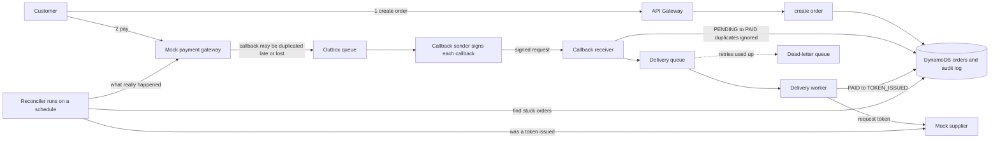
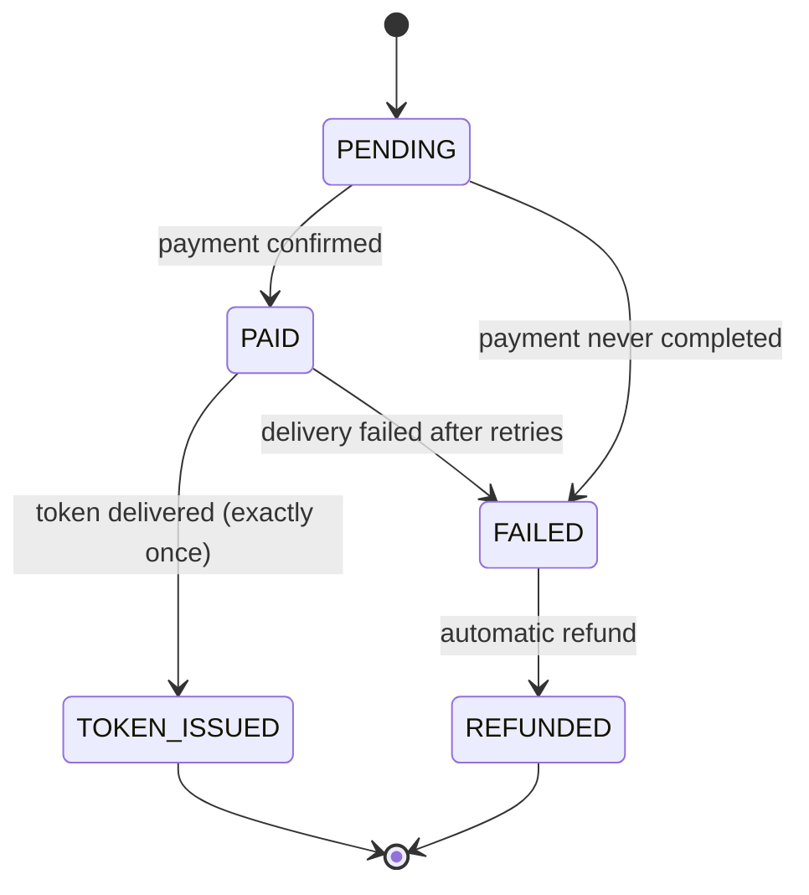

# Tap to Token

**A resilient payment-to-delivery pipeline, built around one painful moment: a customer pays for a ZESA token and nothing arrives.**

Built with Terraform on AWS (Lambda, DynamoDB, SQS, API Gateway, EventBridge, Secrets Manager).

**Demo video:** [https://youtu.be/_fXECni6K5E](https://youtu.be/_fXECni6K5E)

> **Simulation.** This is a project I built to show how I think about payment reliability. It uses a mock payment gateway and a mock electricity supplier. It involves no real payments, no real customers, and it is not connected to or based on any company's internal systems.

---

## 1. The problem in plain English

Imagine a Zimbabwean in the UK. It is the 30th, 9pm, and her mother's electricity in Harare has run out. She buys a ZESA token online and taps **Pay**. The money leaves her account.

Then one of these happens behind the scenes:

| What goes wrong | What the customer experiences |
|---|---|
| The payment confirmation never reaches the system | Paid, but no token. No explanation. |
| The confirmation arrives **twice** | Two tokens issued, or a conflict that issues none |
| The electricity supplier times out **after** the money is taken | Paid, token not delivered, system unsure what to do |
| The customer taps Pay twice or refreshes | Two orders, possibly two charges |

The customer is now stuck in limbo: **paid, but with no token and no clear answer.** She pays again, calls support, or stops trusting the service. For something as essential as electricity, that is a serious failure.

## 2. What this project does

**Tap to Token guarantees that every paid order ends in exactly one of two outcomes:**

1. **The customer receives exactly one token**, or
2. **The customer is automatically refunded.**

No double tokens. No orders stuck forever in "paid but not delivered". No manual cleanup.

It does this even when the surrounding systems misbehave: confirmations arrive twice, arrive late or never arrive, and the supplier times out.

## 3. How it works



### The order lifecycle

Every order moves through a strict set of states. Only the moves below are allowed.



### The five ideas that make it reliable

1. **Idempotency, in two places.** The customer's browser sends a unique key with every purchase, so tapping Pay twice or refreshing returns the original order instead of creating a second one. Separately, every payment confirmation from the gateway carries a unique reference that the database accepts only once, so a duplicate confirmation is ignored and a token can never be issued twice.
2. **Decoupled delivery.** Paid orders go onto a queue. If the supplier times out, the worker retries. If retries keep failing, the message lands in a dead-letter queue instead of disappearing.
3. **Reconciliation.** A scheduled job looks for orders stuck in a state for too long. It asks the gateway or the supplier what really happened, then moves the order forward or refunds it.
4. **A strict state machine.** Updates only succeed if the order is in the expected previous state, which prevents race conditions between the callback receiver, the worker and the reconciler.
5. **An audit log.** Every state change is recorded with a timestamp, written in the same database transaction as the change itself, so the log can never disagree with the order. For any purchase you can see exactly what happened and when.

### The hardest case: the supplier times out

If the supplier goes quiet after the customer has paid, the system cannot tell whether the token was issued. Refunding straight away could leave the customer with a refund **and** a token. So the order ID is sent to the supplier as its own reference, and the supplier hands back the same token if it is asked twice. The reconciler asks the supplier what happened to that reference before it decides to deliver or refund.

## 4. Try the failures yourself

The demo page lets you pick a way for the purchase to go wrong, then shows the audit log as the system recovers:

- Everything works
- The customer taps Pay twice
- The gateway confirms the payment twice
- The confirmation is lost
- The confirmation arrives late
- The supplier times out
  
The demo video above walks through the main ones.

I tear the stack down to avoid ongoing cost, so there is no live link. I can rebuild it with `terraform apply` to show it live.


## 5. The chaos switch

The mock gateway and mock supplier have failure settings that can be changed at runtime (the demo page does this for you):

| Setting | What it simulates |
|---|---|
| `duplicate_callback_rate` | The same confirmation sent more than once |
| `delayed_callback_rate` | Confirmations that arrive late |
| `lost_callback_rate` | Confirmations that never arrive |
| `provider_timeout_rate` | The supplier failing to respond in time |

## 6. How I tested it

The tests run locally against a fake AWS, so they need no account and cost nothing. They cover, among other things:

- a duplicate callback never creating a second token
- a lost callback being recovered by the reconciler
- a supplier that issued a token but whose reply was lost (no refund and no second token)
- a supplier that never issued a token (exactly one refund)
- the same delivery message being processed twice
- invalid state changes being refused
- callbacks with a bad signature or the wrong amount being rejected
- an unreachable or confusing supplier never causing a refund (the system waits until it knows what happened)
  
Run them with `python -m pytest tests/ -q`. I also ran scenarios against the deployed system, shown in the demo video.

## 7. Security and governance

Everything is defined as code with Terraform, so controls are consistent and reviewable.

- Each function has its own IAM role, limited to the tables and queues it uses
- Gateway callbacks are signed, and unsigned or tampered callbacks are rejected
- The signing secret lives in AWS Secrets Manager, never in code
- API throttling limits abuse
- Every state change is audited in the database
- Consistent resource tagging

## 8. Cost awareness
- DynamoDB, Lambda, SQS and API Gateway are all pay-per-use, so an idle stack costs almost nothing
- Every resource carries a project tag so costs can be traced to this project
- I destroyed the stack after recording the demo, and `terraform apply` rebuilds it

I did not measure cost per transaction. That would be the next step.


## 9. Tech stack

| Layer | Tool |
|---|---|
| Infrastructure as code | Terraform |
| API | Amazon API Gateway |
| Compute | AWS Lambda (Python 3.12) |
| Data | Amazon DynamoDB |
| Messaging | Amazon SQS, with dead-letter queues |
| Scheduling | Amazon EventBridge |
| Secrets | AWS Secrets Manager |
| Logs | Amazon CloudWatch |

## 10. Repository structure

```
tap-to-token/
├── README.md
├── terraform/              # all infrastructure as code
│   ├── main.tf, api.tf, dynamodb.tf, lambdas.tf
│   ├── phase2.tf           # queues, extra Lambdas, routes, secret, reconciler schedule
│   ├── demo.tf             # serves the demo page
│   └── modules/lambda_function/
├── src/
│   ├── layer/python/ttt/   # shared state machine, audit log and helpers
│   ├── create_order/       # POST /orders (idempotency key)
│   ├── get_order/          # GET /orders/{id}: order + audit log
│   ├── callback_receiver/  # payment "result URL": signature check, dedupe, PENDING -> PAID
│   ├── delivery_worker/    # asks the supplier for the token
│   ├── reconciler/         # finds stuck orders, asks the supplier, delivers or refunds
│   ├── mock_gateway/       # simulated gateway with the chaos switch
│   ├── callback_sender/    # simulated gateway sending signed callbacks
│   ├── mock_utility/       # simulated electricity supplier (idempotent by reference)
│   └── demo_page/          # the clickable demo page
└── tests/                  # local tests (no AWS account needed)
```

## 11. Running it

```bash
# 1. Tests (no AWS account needed)
pip install boto3 moto pytest
python -m pytest tests/ -q

# 2. Deploy (needs AWS credentials)
cd terraform
terraform init
terraform plan
terraform apply

# 3. Tear everything down
terraform destroy
```

`terraform apply` prints the `api_url`. Opening it in a browser shows the demo page. The file `demo.auto.tfvars` shortens the reconciler's timings so recoveries are visible in a demo. A real system would use longer waits.

## 12. What this project is not

- It uses no real customer data, payment credentials or supplier systems.
- It assumes nothing about any company's internal architecture. The patterns here (idempotency, queues, reconciliation, least privilege, audit logging) are principles I would apply to whatever tools a team already uses.
- It is a simulation, so it is not production-ready. A real system would also need compliance review, real provider integrations, fraud controls, edge protection and far more testing.
- The demo endpoints are public and the failure switch is shared, so two people running scenarios at the same time can interfere with each other.
- I did not build a load test or a naive-versus-resilient comparison, and I did not measure cost per transaction.

## 13. What I would learn and extend with a real team

- Map the controls to the compliance requirements of financial, utility and mobile money integrations
- Add edge protection such as AWS WAF and rate limiting, and test against realistic month-end traffic
- Add budgets, alarms and cost-per-transaction tracking
- Add per-provider success-rate monitoring, so a struggling payment method is visible immediately

## 14. About me

**Nicole Marise**, BCom Information Systems (Rhodes University), hands-on with AWS and Terraform, applying for a Junior Cloud Engineer internship.

Related work: `flowdesk-landing-zone` and my Production-Grade AWS Infrastructure project, both on my GitHub.

## Screenshots


